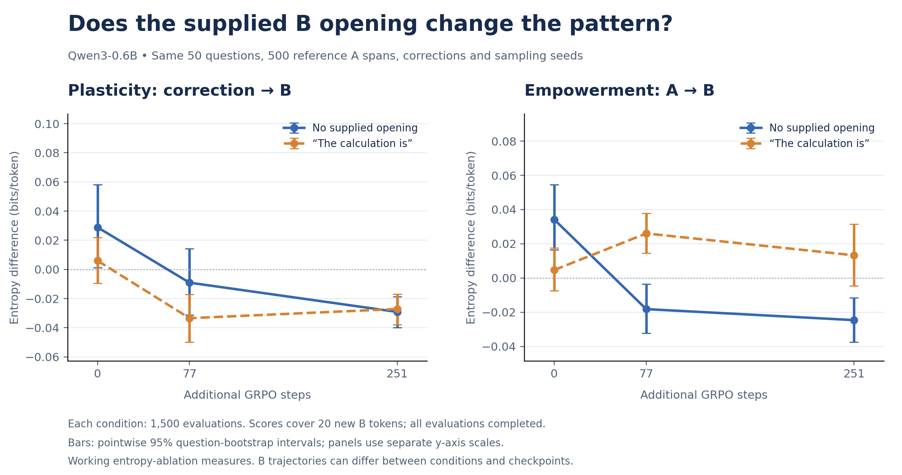
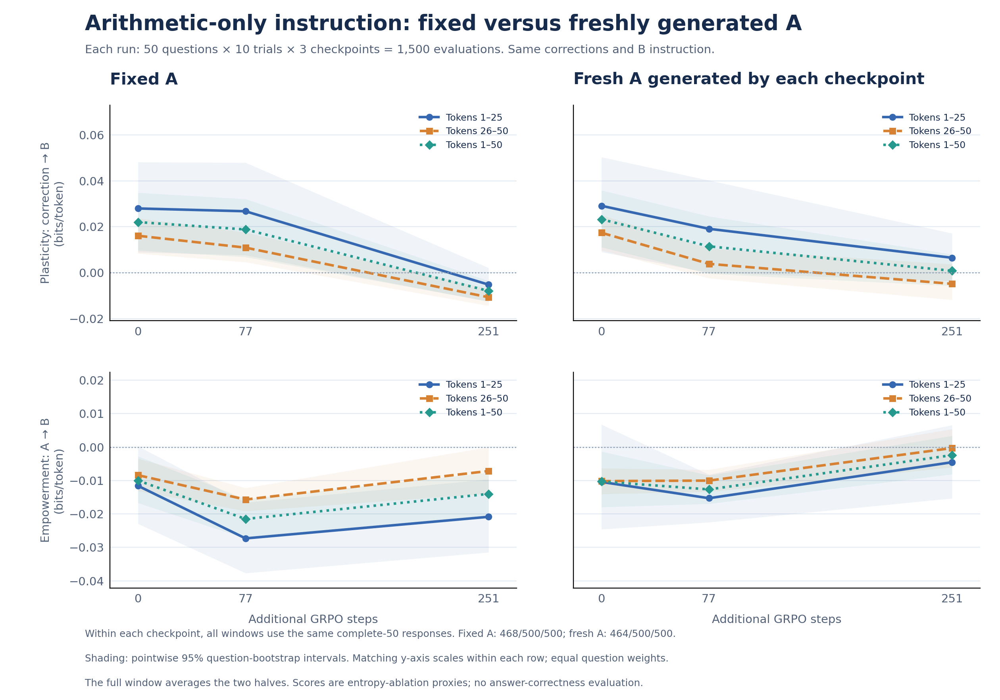
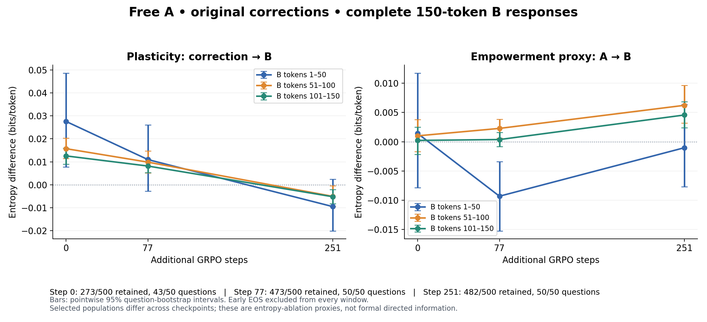
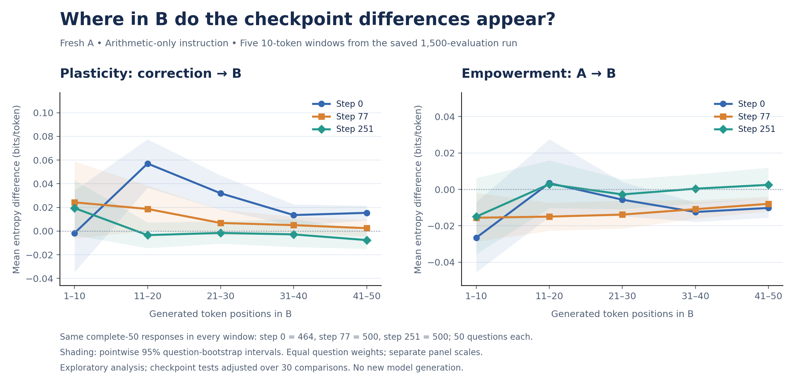

# Research update — November 2, 2026

This update collects the follow-up experiments after the original 200-question Qwen3-0.6B study. All full runs below use the same original 50 question/correction pairs, 10 trials per question, and the pinned checkpoints at 0, 77, and 251 additional GRPO steps. Step 0 already has prior training.

## What is being measured

“Plasticity” and “empowerment” remain working labels for **next-token entropy ablations**, measured in bits/token. They are not established directed information, conditional mutual information, or channel capacity. Removing context is not marginalizing it out. Negative scores mean that including the source increases next-token entropy.

At a B position, correction sensitivity is `H(B_next | X,A,empty_J,B_history) - H(B_next | X,A,J,B_history)`. Earlier-output sensitivity replaces `empty_J` with `empty_A` in the first term. All contexts receive the same generated B history within a rollout. B trajectories may differ between checkpoints and experimental conditions.

## Completed full experiments

| Result folder under `results/` | A | Correction / B opening | Scored B positions | Evaluations |
|---|---|---|---|---:|
| `qwen06b_original50_fixed_a_calculation` | Same 500 saved baseline A spans at every checkpoint | Normal correction; supplied “The calculation is” | 20 newly generated tokens | 1,500 |
| `qwen06b_original50_fixed_a_no_opening` | Same fixed A spans | Normal correction; no supplied opening | 1–20 | 1,500 |
| `qwen06b_fixed_a_arithmetic_50` | Same fixed A spans | Correction plus arithmetic-only instruction | 1–25, 26–50, 1–50 | 1,500 |
| `qwen06b_sampled_a_arithmetic_50` | Fresh 20-token A from each checkpoint | Correction plus arithmetic-only instruction | 1–25, 26–50, 1–50 | 1,500 |
| `qwen06b_sampled_a_normal_150` | Fresh 20-token A from each checkpoint | **Original correction only**, no arithmetic instruction or supplied opening | 1–50, 51–100, 101–150 | 1,500 |

The supplied-opening result was already published in this PR. The remaining bundles are added by this update. Each includes configuration, raw token IDs/entropies, grouped summaries, and available figures. Experimental conditions should not be treated as independent replications of the same protocol.

## Key observations

- Supplying “The calculation is” materially changes the earlier-output sensitivity pattern. Opening choice matters.
- The free-A arithmetic-50 run has declining correction sensitivity; earlier-output sensitivity rises from step 77 to 251, but the reported checkpoint tests do not establish a robust empowerment increase after multiplicity correction.
- In the normal-correction 150-token run, correction sensitivity decreases in all three windows. Earlier-output sensitivity rises numerically across checkpoints in windows 51–100 and 101–150; the first window drops then recovers. These are descriptive trends, not evidence of a universal tradeoff.
- The complete-150 rule retains **273/500, 473/500, and 482/500** responses at steps 0/77/251. Only **43, 50, and 50** questions respectively are represented. Selection by response length differs substantially across checkpoints. A matched-question analysis remains needed; even matching question IDs does not remove selection among trials.
- The five 10-token windows and arithmetic-15 analyses are exploratory analyses of the saved arithmetic-50 run, with no new generation. The arithmetic-15 selector qualifies only **78, 6, and 1** responses across checkpoints, covering **29, 4, and 1** questions. It is unsuitable for a clean checkpoint comparison.

## Figures









## Behavioral audits

### Correction-value mentions in the free-A arithmetic-50 run

An automatic number-mention screen finds old-value-only mentions in **80/500 (16.0%)**, **164/500 (32.8%)**, and **312/500 (62.4%)** responses at steps 0/77/251. Revised-value-only counts are **279, 183, 51**; both-value counts **51, 20, 36**; neither-value counts **90, 133, 101**.

These are **mention categories, not confirmed correction-failure rates**. Numbers can refer to another quantity, a rejected value, or an intermediate result. The return-speed question provides a clearer reviewed example: the old 6-mph return speed is retained in 1/10, 1/10, and 8/10 saved first-50-token responses; corrected 5-mph use appears in 8/10, 6/10, and 0/10. At step 77 one correctly revised response mentions both values. None of this establishes what would happen beyond the cap.

Files: `results/qwen06b_sampled_a_arithmetic_50/correction_audit/`.

### EOS-only answer correctness in the normal-correction 150-token run

Assistant-reviewed final answers were compared with `revised_answer`, not the original GSM8K answer. This scores the final answer, not intermediate reasoning; a matching magnitude with the wrong direction is incorrect. Labels are saved for Ben's independent review.

| Step | EOS responses | Excluded source issues | Correct / graded | EOS-conditional accuracy | Distinct graded questions |
|---|---:|---:|---:|---:|---:|
| 0 | 227 | 6 | 87/221 | 39.4% | 40 |
| 77 | 27 | 0 | 16/27 | 59.3% | 11 |
| 251 | 18 | 0 | 2/18 | 11.1% | 6 |

These are **not overall GSM8K accuracies**. The EOS subset differs greatly by checkpoint. All early-ending responses were excluded from the complete-150 entropy analysis; this answer audit intentionally examines those excluded responses. Source-issue questions `test:1309` and `test:255` are excluded from correctness grading.

Files: `results/qwen06b_sampled_a_normal_150/eos_accuracy/`.

### Opening-length estimate in the normal-correction 150-token run

A regex audit estimates the opening before the first detectable numerical arithmetic expression. Mean/median token counts are **46.9/39**, **72.2/71**, and **78.0/77**, based on 463, 444, and 395 aligned responses with detected arithmetic. Alignment is available for 497, 500, and 495 responses. Responses without detected arithmetic are censored; their full observed length is not averaged as a completed opening.

This is **not a validated semantic count of injection restatement**. Openings include setup, problem restatement, headings, and correction acknowledgments. The narrower revised-value sentence selector requires a revised-number match plus an overlapping content word from the correction, but remains heuristic. Merely mentioning the revised value does not imply correctly applying it. Fixed token positions do not reliably isolate calculation.

Files: `results/qwen06b_sampled_a_normal_150/opening_audit/`.

## Length check and new Daytona speed check

`results/b_length_pilot/` contains a completed five-question fixed-A arithmetic-instruction length check. Mean B lengths were 157.8, 284.0, and 728.6 tokens. Only 1/5 baseline responses reached 150 tokens, versus 5/5 at the other checkpoints. It is a small diagnostic, not a representative free-A estimate.

The new **Daytona CPU speed check — one question, three checkpoints** evaluates a different protocol: generate A to EOS (2,048-token safety cap), require at least 75 A content tokens, insert the normal correction, and score B positions 51–100. The late-A baseline retains A tokens 1–74 and removes tokens 75 onward; the correction baseline retains all A and removes the correction. EOS is excluded from A's selected source span. B EOS before 100 yields a missing complete-window score. This is a tiny infrastructure test, not checkpoint evidence. The test is now complete: step 0 produced A=180 tokens (23.6s) and B scoring took 41.3s; step 77 produced A=334 tokens (47.7s), with B scoring taking 46.1s. Step 251 hit the 2,048-token A cap without EOS after 317.9s, so it has no eligible B score. The sandbox was deleted. The full 50×10×3 late-A experiment has not been launched. See `results/daytona_cpu_speed_check_late_a/README.md`.

## Reproduction and draft status

- `windowed_arithmetic_experiment.py`: fixed-A arithmetic-50 runner.
- `sampled_a_arithmetic_experiment.py`: free-A arithmetic-50 runner.
- `sampled_a_normal150_experiment.py`: completed normal-correction free-A B150 runner.
- `structured_calculation_experiment.py`: contains the shared `generate_b` and `region_summary` helpers used by completed runs. Its separate formatted-response main program was **not** run.
- `sampled_a_arithmetic150_experiment.py`: **unrun draft** with arithmetic instruction; do not confuse it with the completed normal-correction run.
- `analysis/*_control/`: saved analysis/plot scripts; source snapshots and hashes are in `provenance/followups/`.

The older analysis scripts expect `runs/<name>`. To regenerate analyses without model inference, copy a tracked result bundle to its corresponding ignored `runs/` directory. For example:

```sh
mkdir -p runs
cp -R results/qwen06b_sampled_a_normal_150 runs/
python analysis/sampled_a_normal150_control/analyze_results.py
```

Audit scripts inside a copied result bundle use paths relative to that bundle. The opening comparison script expects to live in `runs/fixed_a_no_opening_control/`; copy it there before execution. Stored source hashes describe the exact original runner/helper versions; do not edit snapshots to make an audit pass. Model revisions and sampling configuration are pinned in the saved configs. Source data and known question limitations remain unchanged.

Validation for this update: 20 unit tests passed across the new runner/helper tests and the existing sampled-RLVR tests. The B150 analysis independently recomputes saved entropy differences, primary-inclusion rules, grouped summaries, source hashes, and the 1,500-record uniqueness grid. No correctness or statistical claims should be inferred from the unrun drafts or the one-question Daytona speed check.
