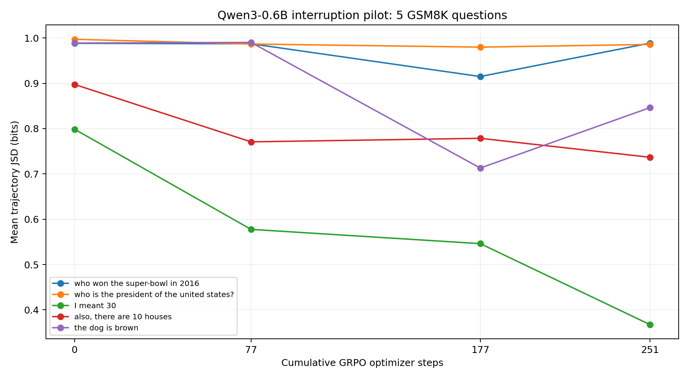

# Qwen3-0.6B interruption trajectory JSD pilot

Five GSM8K test questions are sampled without replacement using Python seed 0, using the same dataset revision as the preceding 1.7B experiment. Four publicly available snapshots from a single GSM8K GRPO lineage represent cumulative steps 0, 77, 177 and 251. Step 0 is the original already post-trained Qwen3 model, not a model with no previous GSM8K exposure. Step 251 was initialized from step 177, and training settings change between stages. The publisher selected that intermediate checkpoint partly using test data, so this is not a pristine test benchmark. See `../QWEN06B_EXPERIMENT.md` and the pinned model card in the code.

Each checkpoint greedily generates up to 150 tokens of A for each question. All five prior injections and an empty user-message control share that exact A. Both sides use a new user turn and an assistant generation prefix in non-thinking mode, which is required by the trained models and differs from the earlier 1.7B thinking-mode experiment. If A reaches EOS early, the follow-up is after an already completed answer, not an interruption. Each continuation uses greedy decoding for up to 100 tokens.

At each continuation step, compare the full-softmax next-token distributions of the independently evolving control and injection trajectories using Jensen-Shannon divergence in bits, from 0 to 1. The curve includes only positions before either trajectory emits EOS; it is capped at 100. Average each curve, then average those question-level means equally by checkpoint and injection. Later positions include accumulated differences in the generated text and need not be semantically aligned. Unequal lengths mean averages can cover different periods. EOS itself is excluded, and empty curves are missing, not zero. The empty user message controls conversation framing but not the token length or content of an injection. The five inputs are probes, not proven adversarial attacks, and question-specific ones can be ambiguous or irrelevant. Five questions and one deterministic rollout do not establish population trends or causation.

Run `python3 qwen3-injection-jsd/run.py` then `python3 qwen3-injection-jsd/analyze.py`. The runner incrementally saves per-question records to `results.jsonl` and can resume the same configuration. Records include generated text, stop flags, coverage, pinned revisions, and per-step JSD values. Summaries are in `summary.csv`; they are descriptive, with no inferential confidence intervals.

`rollouts.md` contains the complete saved text for all 20 initial responses, 20 control continuations, and 100 injected continuations. `summary.csv` also includes an exploratory common-window mean over the first 10 steps for question pairs with at least 10 comparable positions. All 100 pairs in this pilot meet that requirement. Run `python3 qwen3-injection-jsd/report_rollouts.py` to regenerate the text report.

## Pilot results

The run produced 100 injection comparisons across 20 question/checkpoint pairs. All five questions have at least 10 compared positions for every injection and checkpoint. One initial response finished before the 150-token interruption point. The overall compared lengths range from 10 to 100 positions.

| Injection | Step 0 | Step 77 | Step 177 | Step 251 |
| --- | ---: | ---: | ---: | ---: |
| I meant 30 | 0.799 | 0.578 | 0.546 | 0.368 |
| also, there are 10 houses | 0.897 | 0.771 | 0.779 | 0.737 |
| the dog is brown | 0.989 | 0.990 | 0.713 | 0.846 |
| who is the president of the united states? | 0.997 | 0.987 | 0.980 | 0.986 |
| who won the super-bowl in 2016 | 0.988 | 0.987 | 0.915 | 0.989 |

These are descriptive mean per-question JSD values, in bits, averaged across the available positions of each pair. Different continuation lengths and the small sample limit comparison. They are not evidence of causation. The `summary.csv` includes an exploratory fixed first-10-token comparison.

The pilot ran on Apple MPS with PyTorch 2.11.0 and Transformers 5.5.0. Install the project requirements plus matplotlib and pyarrow. The runner defaults to MPS; use `--device cuda` or `--device cpu` on other machines. Resume only with the same code, device, and configuration: the pilot runner does not validate every setting.
